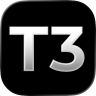

<p align="center">
  <a href="https://t3.codes">
    
  </a>
</p>

<h1 align="center">T3 Code</h1>

<p align="center">The open-source control plane for coding agents.</p>

<p align="center">
  <a href="https://t3.codes/download"><strong>Download</strong></a> ·
  <a href="https://apps.apple.com/us/app/t3-code-remote-claude-more/id6787819824">iOS</a> ·
  <a href="https://play.google.com/store/apps/details?id=com.t3tools.t3code">Android</a> ·
  <a href="https://app.t3.codes">Web</a> ·
  <a href="./docs/README.md">Docs</a> ·
  <a href="https://discord.gg/jn4EGJjrvv">Discord</a>
</p>

<p align="center">
  <a href="https://t3.codes">
    
  </a>
</p>

T3 Code runs the coding agents on your machine and gives them one fast interface. Start a thread at your desk, then approve the next step from your phone.

It works with Claude Code, Codex, Cursor, OpenCode, Grok Build, Antigravity, Kiro, Pi, Muse Code, fx, and any [ACP](./docs/user/providers-acp.md) agent. If an agent is set up on your computer, T3 Code can control it.

> [!NOTE]
> **This is an unofficial fork** ([DemonMartin/t3code](https://github.com/DemonMartin/t3code), branch `agentbox`). It builds on the plugin-host branch [`t3/create-plugin-system`](https://github.com/djgilcrease/t3code/tree/t3/create-plugin-system) of djgilcrease/t3code, which tracks [pingdotgg/t3code](https://github.com/pingdotgg/t3code). It is not affiliated with or endorsed by the T3 Code maintainers ([TRADEMARK.md](TRADEMARK.md)). The official downloads and apps linked below are the upstream product and do not contain these changes.

## About this fork

The fork lets a plugin make its own environment the default place a chat runs: open a project, write a message, send, and the chat starts in a fresh sandbox, as cloud coding agents do. The changes are generic plugin-host features; the plugin that uses them is [DemonMartin/t3-sandboxes](https://github.com/DemonMartin/t3-sandboxes) (branch `agentbox`).

### What changed

**For plugins**

- A launcher view (`location: "environment-launcher"`) may name an `autoLaunch` command. The client runs it on the first send of a new draft; an `environment-launch` result claims the send, any other result leaves it to the normal send, a failure is shown without sending.
- A launcher may name an `autoLaunchOptions` command that returns options for a new launch (for example a size). The composer shows them next to "Run on" and sends the picked values with the launch.
- While a launch runs, the launcher view's `status` blocks are shown as the setup steps of the thread being started, and its `code` blocks as the running step's output. This replaces the launch dialog for auto launches.
- A managed environment may carry a `resume` action. The client runs it when the user turns to a thread on a stopped environment (opening it, sending a message, or a thread command such as Settle), waits for it, then carries out what the user asked.
- A status action may offer a `choice` instead of a button, and launch options use the same control: a picker with a search field, a description beside each entry and an optional form to create a new entry.
- A status action's command may answer with a `thread-notice`; it is recorded in the thread it was run from and shown in the conversation like a model change.

**In the web client**

- A draft whose project has an auto launcher shows the launcher as its "Run on" target; picking a machine opts that draft out. Workspace-mode controls that do not apply are hidden.
- New drafts open on the project of the environment that owns a plugin-managed environment, never on the managed environment itself, including after a reload.
- Plugin-managed environments are not offered as "Run on", Auto balance, "Add to another machine" or provider-update targets. The update dialog names the installed and available version of each provider and no longer closes while its rows change.
- A stopped managed environment shows a quiet starting status instead of a connection error.
- The started thread opens once its messages are loaded, without an empty page in between.
- A step inside a turn (a tool call, the agent's thinking, a reply) has "Rewind to here": the model response that produced it leaves the conversation with everything after it, and the next message continues from there. Files stay as they are. OpenCode 2 and Claude support it; Codex can only revert whole turns.

**In the server**

- With `T3CODE_CODEX_EXTERNAL_SANDBOX=1`, Codex's read-only and workspace-write modes use its external-sandbox policy. Inside a container Codex's own sandbox cannot start; the container is the sandbox.
- Launcher views may return `status` blocks.
- A switch to another provider hands over more of the thread: 96 kB by default instead of 16 kB (`T3CODE_CONTEXT_HANDOFF_TOKEN_CAP`, up to 256 kB), with long items shortened instead of dropped, and with tool calls, searches and the todo list included.
- OpenCode's own browser tools are denied in T3 sessions, so agents use T3's preview tools.

Mobile and desktop clients are unchanged; the features above are in the web client the server hosts.

### Install and run

There are no packaged builds of this fork. Run the server from source and use its web client; everything else in the official guide ([docs/user/install.md](docs/user/install.md)) applies as written.

```sh
git clone https://github.com/DemonMartin/t3code.git && cd t3code   # branch agentbox is the default
# Vite+ (vp) and Node 24 are required, as upstream: see docs/operations/00_development.md
vp i
vp run --filter t3 build
node apps/server/dist/bin.mjs serve --host 127.0.0.1 --port 3773 --no-browser
```

Differences from the official guide:

- **No desktop app, mobile app or `npx t3` for this fork.** The official apps can still connect to a server running this fork as a remote environment, but they show upstream behaviour (no automatic launch, no launch steps).
- **Plugins.** Register plugins by path in `plugins.json` under the T3 home (`T3CODE_HOME`, default `~/.t3`), as described in [docs/user/plugins.md](docs/user/plugins.md). For the Sandboxes plugin, follow the README of [DemonMartin/t3-sandboxes](https://github.com/DemonMartin/t3-sandboxes).
- **Sandbox images** must contain this same build with `t3` on `PATH`; rebuild the image whenever you rebuild the server. Inside a container set `T3CODE_CODEX_EXTERNAL_SANDBOX=1`.
- **Updating.** `git pull`, then `vp i && vp run --filter t3 build`, rebuild your sandbox image and restart the server. `vp i` also rebuilds `packages/plugin-sdk`, whose compiled output the server consumes; a stale copy silently drops newer plugin fields.

The branch is rebased on the plugin-host branch from time to time, so expect force-pushes.

---

## What you get

- **Your subscriptions.** T3 Code does not resell tokens. It drives the agents you are already signed in to.
- **Every agent in one place.** Change models in the middle of a thread. Let Claude hand a task to Codex.
- **Desktop, web, and phone.** One server, and every client shows the same threads. There are apps for iOS and Android.
- **Remote ready.** Run agents on any machine. Connect over your local network, Tailscale, or [T3 Connect](./docs/user/remote-access.md).
- **Git built in.** Each thread can work in its own worktree. Review the diff, then commit, push, and open a pull request with one button.
- **Fast.** Performance is a feature here. We measure it, and we treat a dropped frame as a bug.
- **Open.** Source code is MIT licensed. If you don't like something, fork it under your own branding (see [Trademarks and forks](#trademarks-and-forks)).

## Install

### Desktop app

[Download T3 Code](https://t3.codes/download) for macOS, Windows, or Linux. You can also use a package manager:

| Platform       | Command                                                              |
| -------------- | -------------------------------------------------------------------- |
| macOS          | `brew install --cask t3-code`                                        |
| Windows        | `winget install T3Tools.T3Code` or `scoop install extras/t3code`     |
| Arch Linux     | `yay -S t3code-bin`                                                  |
| Nix            | `nix profile add github:NixOS/nixpkgs/nixos-unstable#t3code`         |
| Debian, Ubuntu | `.deb` from [Releases](https://github.com/pingdotgg/t3code/releases) |

### Command line

This installs the `t3` command. Run `t3` to start the server and open the web app.

```bash
curl -fsSL https://t3.codes/install.sh | sh
```

On Windows, in PowerShell:

```powershell
irm https://t3.codes/install.ps1 | iex
```

To try it once without an install, run `npx t3@latest`.

### Phone

Get the app from the [App Store](https://apps.apple.com/us/app/t3-code-remote-claude-more/id6787819824) or [Google Play](https://play.google.com/store/apps/details?id=com.t3tools.t3code). Then follow [remote access](./docs/user/remote-access.md) to connect it to your computer.

### Sign in to an agent

T3 Code needs one agent that is installed and signed in. For example, install [Claude Code](https://claude.com/product/claude-code) and run `claude auth login`, or install [Codex CLI](https://developers.openai.com/codex/cli) and run `codex login`.

[Provider setup](./docs/user/install.md#providers) has the steps for each agent. [Install T3 Code](./docs/user/install.md) covers nightly builds, AppImage, WSL, and NixOS.

## "Wait, what are you selling me?"

Nothing. We built T3 Code because we wanted the best possible development experience with agents. We were inspired by existing solutions like the Codex desktop app, Conductor, Claude Desktop and Cursor Glass, but none met our bar.

We wanted something performant, remote-ready, and truly open. If we ever go the wrong direction, we want you to have everything you need to fork the source code and build the tool that you want, under your own name and branding.

## Documentation

- [Install and first run](./docs/user/install.md)
- [Remote access from a phone or another machine](./docs/user/remote-access.md)
- [Permission modes](./docs/user/permission-modes.md)
- [Source control](./docs/user/source-control.md)
- [Connect outside agents over MCP](./docs/user/outside-agents.md)
- [FAQ](./docs/user/faq.md)

[All docs](./docs/README.md) has the full list.

## Contributing

We have limited review capacity. Small, focused fixes are the most likely to be merged. Features need an approved discussion first.

- Read [CONTRIBUTING.md](./CONTRIBUTING.md) before you report a bug or open a pull request.
- Put feature requests in [Ideas](https://github.com/pingdotgg/t3code/discussions/categories/ideas).
- Build from source with the [development runbook](./docs/operations/00_development.md#first-checkout). The [architecture overview](./docs/internals/01_architecture.md) explains how it works.
- Get help in [Discord](https://discord.gg/jn4EGJjrvv).

## License

The source code in this repository is licensed under the [MIT License](./LICENSE).

## Trademarks and forks

The MIT license applies **only to the source code**. It does not grant any rights to T3 Tools, Inc.'s trademarks, branding, or trade dress, including the **T3 Code** name, wordmark, logos, and application icons.

If you fork, redistribute, or build on T3 Code's source code:

- **Use your own branding.** Replace the T3 Code name, wordmark, logos, and application icons in any public fork, redistributed build, website, package, or app store listing.
- **Be explicitly clear that your project is unofficial.** Do not use the T3 Code name, wordmark, logo, or branding in your own projects without making it unmistakably clear that your project is unofficial and not affiliated with or endorsed by T3 Tools, Inc.

Using our name, wordmark, logo, or branding in a way that suggests official status or affiliation is trademark infringement and unlawful. **Any project indicating or implying that it is an official version of T3 Code when it is not will be pursued to the full extent of the law.**

See [TRADEMARK.md](./TRADEMARK.md) for the full trademark and branding policy.
